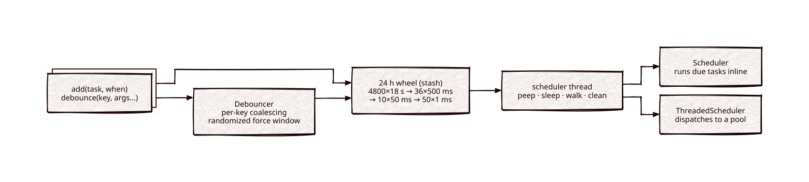

# scheduler

[](https://github.com/Kronuz/scheduler/actions/workflows/ci.yml)
[](LICENSE)


A C++20 timer-wheel scheduler and a per-key debouncer: schedule cancellable tasks
up to 24 hours ahead at 1 ms resolution, and collapse bursts of calls for the same
key into one. For services that run timers, deferred flushes, or rate-limited
background work.



## ✨ Highlights

- **A 24-hour wheel at 1 ms resolution** built on the lock-free
  [stash](https://github.com/Kronuz/stash) slot store: adding a task never takes a
  lock.
- **Cancellable tasks.** `clear()` is one compare-and-swap; a cleared task is
  skipped when the wheel reaches it.
- **Two runners.** `Scheduler` runs due tasks inline on its thread;
  `ThreadedScheduler` dispatches them to a worker pool, so a slow task cannot stall
  the wheel.
- **A debouncer** that coalesces rapid touches of a key into one call with the
  latest arguments, with a randomized force window so a key touched forever still
  fires and many keys due at once spread out.
- **Optional throttling**: a floor on how often a key can fire.

## 📦 Installation

Requires a C++20 compiler and CMake 3.14 or newer. It fetches
[stash](https://github.com/Kronuz/stash) and
[threadpool](https://github.com/Kronuz/threadpool) at their `main` tips. CI builds
it on Linux (x86_64, arm64), macOS (arm64, x86_64), and FreeBSD, plus ASan, UBSan,
and TSan builds.

```cmake
include(FetchContent)
FetchContent_Declare(scheduler
  GIT_REPOSITORY https://github.com/Kronuz/scheduler.git
  GIT_TAG        main)
FetchContent_MakeAvailable(scheduler)

target_link_libraries(my_app PRIVATE scheduler::scheduler)
```

## 🚀 Quick start

A task is a class deriving from `ScheduledTask` (CRTP) with an `operator()`:

```cpp
#include "scheduler.h"

#include <chrono>
#include <memory>

struct Ping;
using Sched = Scheduler<Ping>;
struct Ping : ScheduledTask<Sched, Ping> {
	void operator()() { /* runs on the scheduler thread when due */ }
};

int main() {
	Sched sched("SCHED");
	auto ping = std::make_shared<Ping>();
	sched.add(ping, std::chrono::steady_clock::now() + std::chrono::milliseconds(200));
	ping->clear();     // cancel: if it has not run, it never will
	sched.finish();
}
```

A debouncer deduces its argument types from the callback:

```cpp
#include "debouncer.h"

using namespace std::chrono_literals;

auto deb = make_debouncer<int>("DEB", "DW{:02}", /*threads*/ 2,
	[](int key, int value) { /* once per settled key, with the latest value */ },
	/*throttle*/ 0ms, /*timeout*/ 50ms, /*busy timeout*/ 50ms,
	/*force window*/ 150ms, 250ms);

for (int v = 0; v < 100; ++v) { deb.debounce(1, /*key*/ 1, /*value*/ v); }
// The callback runs about once for key 1, with value 99.
```

[`examples/demo.cc`](examples/demo.cc) tours both: ordering, cancellation, a
worker pool, and a debounced burst.

## 🎯 When to use it

- ✅ Many timers or deferred jobs, cancelled often, at millisecond resolution:
  timeouts, deferred commits and flushes, retries.
- ✅ Coalescing bursts per key: "fsync this file soon", "replicate this shard soon".
- ❌ Sub-millisecond deadlines or hard real-time: the wheel's resolution is 1 ms
  and tasks run on a regular thread.
- ❌ Tasks more than 24 hours out: they overflow the wheel and are dropped (and
  logged through the trace hook).

## 📚 Documentation

- [docs/API.md](docs/API.md): `ScheduledTask`, `Scheduler`, `ThreadedScheduler`,
  `Debouncer`, and the tracing hooks.
- [ARCHITECTURE.md](ARCHITECTURE.md): the wheel, the thread loop, the two runners,
  and the debouncer's timing model.
- [AGENTS.md](AGENTS.md): repository map, invariants, and traps.
- [examples/colored_trace/](examples/colored_trace/README.md): plugging in colored
  tracing.

## 🛠️ Building and testing

```sh
cmake -B build && cmake --build build && ctest --test-dir build
./build/scheduler_demo
```

The tests are timing-based with generous windows; they also check that a touch
arriving at the debouncer's force deadline still delivers its value.

## 🤝 Contributing

Issues and pull requests are welcome. Read [AGENTS.md](AGENTS.md) first: it lists
the invariants a change must keep. CI must pass on every platform.

## 📄 License

MIT, Copyright (c) 2015-2019 Dubalu LLC. See [LICENSE](LICENSE). Extracted from
[Xapiand](https://github.com/Kronuz/Xapiand), where it drives the logger thread and
every debounced fsync, commit, and replication trigger.
